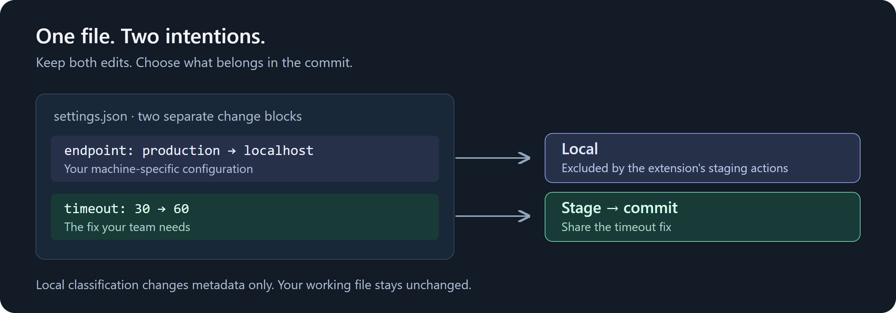

# Local Change Guard

**Keep local edits out of commits. Open another branch without disturbing unfinished work.**

[Install for VS Code](https://marketplace.visualstudio.com/items?itemName=oxara.local-change-guard) · [Usage guide](docs/USAGE.md) · [Support](SUPPORT.md)

Your test endpoint and a real bug fix can live in the same tracked file. Local Change Guard remembers which changes should stay on your machine and which are ready to share—without hiding either from Git.

## Keep local changes local

Mark a change block as **Local**, then stage your shareable work from **Changes**. The extension excludes Local changes from its staging actions. Classifying a change leaves the file and Git index untouched.

**Example:** keep your developer endpoint Local while committing a timeout fix in the same file.

## Select once. Apply once.

Select changes, files or entire folders. In tree view, folder selection includes collapsed subfolders; with a search filter active, it includes only matching changes.

Stage, unstage or change classifications together, with **one short confirmation for the batch** and an **Undo** action afterward. Only applicable actions appear.

**Example:** select a feature folder and stage its changes together, excluding Local edits.

## Open Branch Safely

An urgent fix should not interrupt your unfinished feature. **Open Branch Safely** creates or reuses an isolated Git worktree and opens it in another VS Code window. Your current files, staged changes and Local assignments stay in their workspace.

The worktrees share repository history; no second clone is needed. Give each workspace a name, then return to it through **Manage Branch Workspaces**. Rename or explicitly delete eligible workspaces there; cleanup is never automatic.

**Example:** leave your feature in progress, open a hotfix branch separately, then return to where you left off.

[See the workspace diagram and workflow →](docs/USAGE.md#branch-workspaces)

## Get started

1. Install the extension and open a trusted Git workspace.
2. Open the shield in the Activity Bar. Right-click a machine-specific change and choose **Classify This Hunk as Local (No Git Change)**.
3. Select shareable work under **Changes**, stage it and confirm the summary.

Click a change to inspect its diff. **Formatting** highlights cosmetic changes; **Risk** flags staged Local content or an outdated classification. Open Risk to review and resolve it.

> **Preview:** Local protection applies to this extension's actions. Other Git tools can still stage Local content; Pre-commit Check reports Risk but does not block commits. Review your staged diff before committing.

## Documentation

[Usage, settings and limitations](docs/USAGE.md) · [Privacy](PRIVACY.md) · [Support](SUPPORT.md)

No telemetry. [Security](SECURITY.md)

By [Oxara](https://erdemozkara.com/). [Apache 2.0](LICENSE) · [Trademarks](TRADEMARKS.md) · [Third-party notices](THIRD_PARTY_NOTICES.txt)
