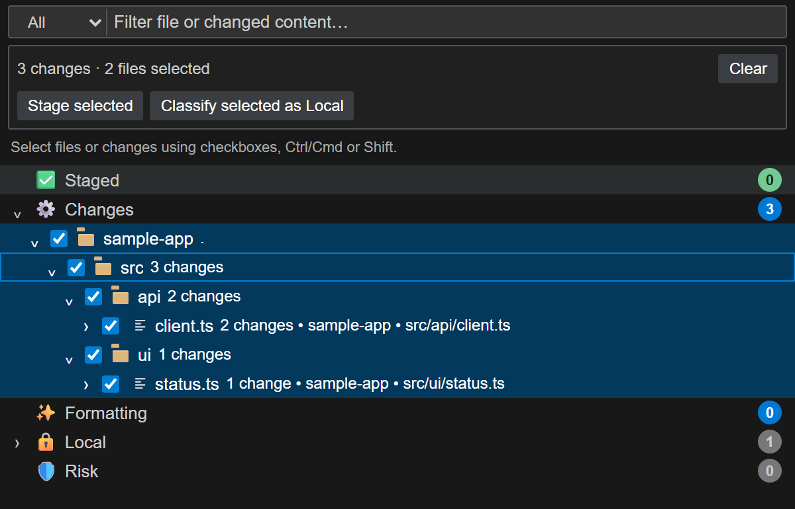
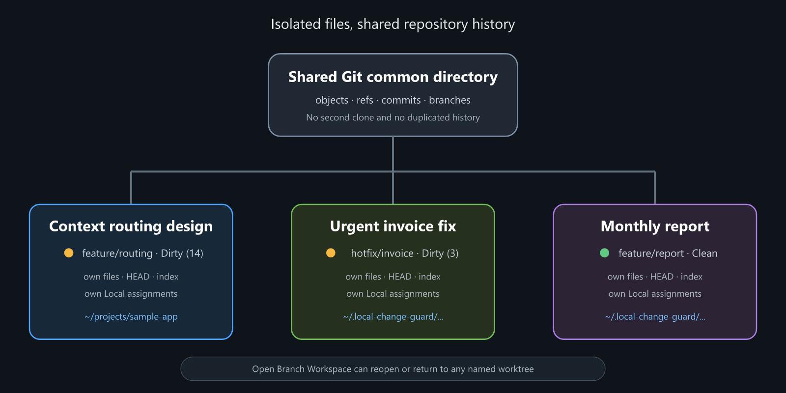

# Usage guide

[← Overview](../README.md)

[Select and act](#select-and-act) · [Resolve Risk](#resolve-risk) · [Branch workspaces](#branch-workspaces) · [Settings](#settings)

## Select and act

*Actual extension interface with example data.*

Open the shield in the Activity Bar. Use **View as Tree** for project → folder → file → change navigation, or **View as List** for a flatter view.

| Select | What it includes |
| --- | --- |
| Change checkbox | One change block, also called a hunk. |
| File checkbox | All matching changes in that file. |
| Folder or project checkbox | All matching descendant changes, even in collapsed subfolders. |
| Ctrl/Cmd-click | Toggle a row without clearing other selections. |
| Shift-click | Select a range of visible rows. |

A mixed checkbox means only some descendant changes are selected. Clicking it selects the rest. Right-clicking a partially selected folder selects its complete filtered subtree.

The selection bar counts unique changes and files. Choose an action there or right-click the selected rows:

| Selected group | Available batch actions |
| --- | --- |
| Changes / Formatting | Stage selected; Classify selected as Local |
| Local | Return selected to Changes |
| Staged | Unstage selected |

Mixed ownership groups have no common mutation action. Formatting is an additional view of Changes; selecting the same change in both places never processes it twice. Empty or inapplicable actions stay hidden.

### Search and inspect

Search file paths, changed content or both. Multiple words must all match. A selected folder includes only the changes matching the current filter; a new filter removes hidden changes from your selection.

Click a file for its complete side-by-side diff, or a change for a focused before/after comparison. Filtering and opening diffs leave your files, classifications and Git index untouched.

### Confirm and undo

Every stage, unstage or classification operation has one compact confirmation: action, file/change counts, Local exclusions and effect. **Apply operation** applies the batch once. Cancel leaves it untouched. Content is revalidated before applying; a stale selection is rejected.

The result offers **Undo** for the batch. Undo refuses to overwrite newer classifications or staged edits in the affected scope. Working files and unrelated staged files stay untouched. Undo is bounded, session-local history—not a substitute for Git.

### Keyboard shortcuts

| Key | Action |
| --- | --- |
| Ctrl/Cmd+F | Focus the filter |
| Escape | Close the menu, or clear the filter |
| Arrows | Navigate and expand/collapse rows |
| Space | Toggle the focused selection |
| Enter | Open the diff, or expand/collapse a folder |
| Shift+F10 | Open the context menu |

## Resolve Risk

**Risk** means either a Local change reached Git's index or a saved Local classification no longer matches safely. The extension shows the reason; it never guesses the intended replacement.

Open the Risk change or choose **Review and Resolve This Risk**. Depending on the state, you can:

- Unstage the affected Local content.
- Select the current changes that should remain Local and replace the old assignment.
- Remove only the outdated classification, leaving file content and the Git index unchanged.

Each resolution uses the same single scope confirmation. Resolve a file's Risk before staging more content from that file through the extension. Other files remain available.

**Pre-commit Check** reports unresolved Risk. It is advisory: Git commands, built-in Source Control and other tools can bypass the extension's Local exclusions. Always review the staged diff.

## Branch workspaces

Use **Open Branch Safely** when another branch needs attention. It creates or reuses an isolated Git worktree and opens it in another VS Code window. Your current worktree is not checked out, stashed or rewritten.

Worktrees share Git objects and branches, while keeping separate files, indexes, working changes and Local assignments. Give each workspace a memorable name; unnamed older worktrees must be named before opening.

**Manage Branch Workspaces** lists name, branch, path and change summary. Open a row to resume work; use its edit or delete button to manage it.

- **Rename** changes only the display name.
- **Delete a clean linked worktree** removes its checkout and name, preserving the Git branch.
- **Delete a dirty worktree** also permanently removes its staged, working and untracked changes. A modal and an exact typed name/branch are required.
- The primary, current, locked and detached worktrees cannot be deleted through the extension. Cleanup is never automatic.

The extension checks the source workspace before and after creation. If it detects a mismatch, it reports the failure and preserves the new worktree for inspection.

## Limits to know

- Untracked text files, binary files and files over 1 MiB are handled as whole-file changes.
- Formatting detection covers line endings, trailing whitespace and final newlines.
- Local protection applies to extension actions, not Git commands or other tools.
- The extension runs only in trusted, file-system-backed workspaces.

## Settings

| Setting | Default | Purpose |
| --- | --- | --- |
| `localChangeGuard.autoRefreshSeconds` | `5` | Refresh while visible; `0` disables polling. |
| `localChangeGuard.showFormattingGroup` | `true` | Show the extra Formatting view. |
| `localChangeGuard.worktreeRoot` | empty | Override the managed worktree location. |

Default worktree location: `~/.local-change-guard/worktrees/<repository-id>/<branch>-<ref-hash>`.

Local assignments: `<worktree-git-dir>/local-change-guard/assignments.v1.json`.

Workspace names: `<git-common-dir>/local-change-guard/workspaces.v1/<worktree-id>.json`.

These metadata files stay outside tracked project content. See [Privacy](../PRIVACY.md) for data handling and retention details.
